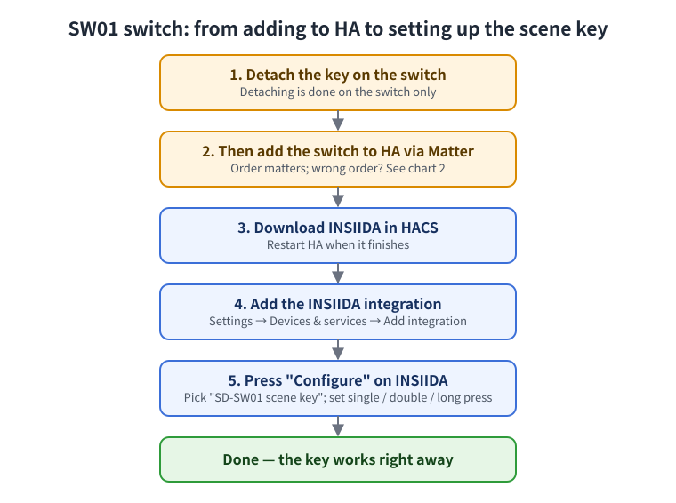
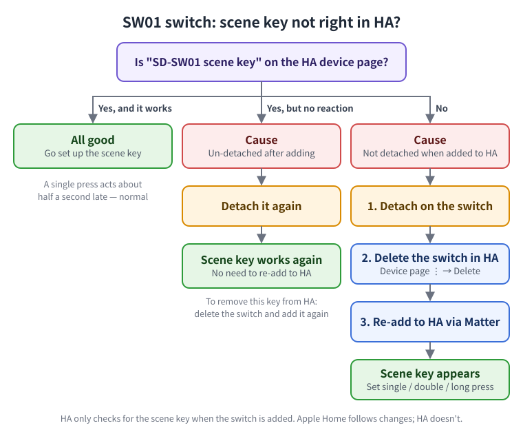

# INSIIDA

[中文](README.md) | **English**

[](https://my.home-assistant.io/redirect/hacs_repository/?owner=insiida&repository=insiida-home-assistant&category=integration)
[](https://my.home-assistant.io/redirect/config_flow_start/?domain=insiida)

[](https://hacs.xyz/)
[](https://github.com/insiida/insiida-home-assistant/releases)
[](https://github.com/insiida/insiida-home-assistant/actions/workflows/validate.yaml)

<!-- Screenshots to come: docs/images/ -->

## Overview

**INSIIDA** is the [Home Assistant](https://www.home-assistant.io/) (HA) companion integration for INSIIDA smart switches and sensors.

- Once a switch is added to HA through Matter, you can already control it — no integration needed for that.
- With this integration you can **set up scene keys by pointing and clicking** (what a single, double or long press does), and see **signal strength, reboot count** and other diagnostics on the device page, which makes problems easy to track down.

<!-- Screenshot: docs/images/overview.png (integration page + device diagnostics) -->

## Why use it

- **Point and click**: pick lights, scenes or scripts under "Configure". No automations to write.
- **Local only**: everything runs inside your own HA. No cloud; works without internet.
- **Read-only**: the integration only reads device information. It never changes switch settings.
- **Easy troubleshooting**: signal quality (Excellent / Good / Fair / Poor), network role, reboot count and last boot at a glance. When a switch misbehaves you can tell a signal problem from a power problem, and download a diagnostics file to send us.
- **New devices join automatically**: INSIIDA devices you add later are picked up without re-adding the integration.
- **Remove any time**: delete the integration and the switches keep working as before.

## Supported devices

| Device | Light on/off | Scene keys | Diagnostics |
|---|---|---|---|
| SW01 smart switch | ✅ built into HA | ✅ one scene key; detach it on the switch first, then add to HA — see below | ✅ signal quality, signal strength, network role, reboot count, last boot |
| SS01 sensor | ✅ built into HA | — | ✅ same (the three signal items from firmware 1.0.1; earlier firmware has reboot count and last boot only) |

## At a glance



## Requirements

- Home Assistant 2025.1 or newer (tested on 2026.3).
- IPv6 enabled in HA: "Settings → System → Network", set IPv6 of the main interface to "Automatic".
- A Thread border router at home (for example HomePod mini, Apple TV 4K, or a Thread radio on HA).
- Devices already added to HA through Matter: "Settings → Devices & services → Matter → Add device".
- [HACS](https://hacs.xyz/) installed (for options 1 and 2).

## Install

### Option 1: one click (recommended)

1. Open this page on your phone or computer and press the **"Open in HACS"** button at the top.
2. The first time, you are asked for your HA address. Fill it in and press "Open link".
3. HA opens the INSIIDA page. Press **"Download"** at the bottom right.
4. When it finishes, **restart HA** as prompted.

<!-- Screenshot: docs/images/install_hacs.png -->

### Option 2: add it in HACS

1. Open HACS → **⋮** at the top right → **"Custom repositories"**.
2. Repository: `https://github.com/insiida/insiida-home-assistant`, Type: **"Integration"**, then "Add".
3. Search HACS for **INSIIDA**, open it → **"Download"**.
4. **Restart HA** when it finishes.

> Once INSIIDA is in the HACS default store, you can skip steps 1 and 2 and just search for "INSIIDA" in HACS.

### Option 3: copy by hand

For people who don't use HACS:

1. Download the latest [release](https://github.com/insiida/insiida-home-assistant/releases) archive.
2. Copy its `custom_components/insiida` folder into the `custom_components` folder of your HA configuration directory.
3. Restart HA.

## Add the integration

1. Press the **"Add the INSIIDA integration"** button at the top,
   or in HA go to "Settings → Devices & services → Add integration" and search for **INSIIDA**.
2. The INSIIDA devices found are listed. Press **"Submit"**.

Each INSIIDA device page then shows these diagnostics:

| Item | What it means |
|---|---|
| Signal quality | **Excellent**, **Good**: fine. **Fair**: may respond slowly now and then. **Poor**: drops out easily — add a mains-powered Matter/Thread device nearby to relay the signal |
| Signal strength | The number behind signal quality (dBm); closer to 0 is better: -65 and above is "Excellent", -66 to -75 "Good", -76 to -85 "Fair", below -85 "Poor" |
| Network role | **Router**: mains-powered, relays signal for other devices. **Leader**: manages the whole network. **Standby router**: can become a router when needed. **End device**, **Sleepy end device**: only connect to others, don't relay. **Not joined**: not on the network yet |
| Reboot count | Should rarely go up. If it keeps rising, the device keeps losing power or restarting — check the power supply and wiring |
| Last boot | When the device last started |

The values refresh about every 10 minutes. When a device is offline these items show "Unavailable".

Signal quality, signal strength and network role need firmware support (SS01 firmware before 1.0.1 doesn't have them). Without it these three items aren't shown; after a firmware update that adds them, the integration picks them up automatically — no reinstall needed.

**When you contact us about a problem**: on the device page press **⋮** at the top right → **"Download diagnostics"** and send us the file. It only contains the integration's settings and the diagnostics above — no pairing codes, passwords or other private data.

<!-- Screenshots: docs/images/add_integration.png, docs/images/diagnostics.png -->

## Set up scene keys

1. Detach the key on the switch first, then add the switch to HA (the order matters — see "Detach first, then add to HA" below).
2. In HA go to "Settings → Devices & services → INSIIDA" and press **"Configure"**.
3. Pick the scene key (listed as "SD-SW01 scene key") and press "Submit".
4. Choose what you need:
   - **Single press**: which lights to toggle (with several lights: if any is on, all turn off; if all are off, all turn on);
   - **Double press**: which scenes or scripts to start;
   - **Long press**: which scenes or scripts to start.
5. Press "Submit". It takes effect right away. Leave unused presses empty.

<!-- Screenshot: docs/images/options_key.png -->

**Detach first, then add to HA**

The SW01 scene key only appears after you **detach** it on the switch (detaching is done on the switch only), and HA only checks once — at the moment the switch is added:

| What happened | Scene key in HA | What to do |
|---|---|---|
| Detached on the switch first, then added to HA | Present, works | Nothing (recommended) |
| Added to HA first, detached later | Missing | Remove the switch in HA and add it again |
| Un-detached after adding | Still listed, but pressing does nothing | Detach again and it works; to make it go away, remove and re-add the switch |



Apple Home follows detach changes automatically; HA doesn't. So the two may show different things — that is normal.

**Tips for pressing**

- **A single press acts about half a second late**: the switch first makes sure you aren't double-pressing. This is normal.
- **Double-press quickly**: like a mouse double-click. With a longer pause it counts as two single presses.

## Without the integration: scene key blueprint

Blueprints are built into HA — no HACS, no restart.

[](https://my.home-assistant.io/redirect/blueprint_import/?blueprint_url=https%3A%2F%2Fgithub.com%2Finsiida%2Finsiida-home-assistant%2Fblob%2Fmain%2Fblueprints%2Fautomation%2Finsiida%2Finsiida_sw01_scene_key.yaml)

Press "Import blueprint", then "Create automation", pick the scene key, choose what single, double and long press do, and save.

If the button doesn't work: "Settings → Automations & scenes → Blueprints → Import blueprint", and paste this address:

```
https://github.com/insiida/insiida-home-assistant/blob/main/blueprints/automation/insiida/insiida_sw01_scene_key.yaml
```

**Use one way per key**: don't set an action for the same press of the same key in both the integration and a blueprint, or it runs twice.

## Uninstall

1. "Settings → Devices & services → INSIIDA" → **⋮** → **"Delete"**.
2. In HACS find INSIIDA → **⋮** → **"Remove"**.
3. Restart HA.

The switches and sensors themselves are not affected.

## Will HA updates break it?

- **The switch itself is never affected**: light on/off, the wall keys and voice control all go through HA's built-in Matter.
- **Scene keys**: only use public HA features, so they normally keep working after updates.
- **Diagnostics**: if a major HA release changes Matter internals, diagnostics may show "Unavailable" for a while, but scene keys keep working and HA is not harmed. We test against new HA releases and ship fixes through HACS — just press "Update".

## More ideas

### Script + card

To make a dashboard card and the wall key do the same thing:

1. Create a script with what a single press should do — see [`cards/sw01_script_example.yaml`](cards/sw01_script_example.yaml);
2. In the integration or the blueprint, let single press run that script;
3. Let the dashboard card run the same script when tapped.

From then on you only edit the script, and the wall key and the card change together.

### Apple-style cards

[`cards/sw01_apple_style.yaml`](cards/sw01_apple_style.yaml) has two Apple Home–style cards. They need **button-card**, installed through HACS.
If you don't want extra cards, use [`cards/sw01_tile_basic.yaml`](cards/sw01_tile_basic.yaml), which only uses built-in HA cards.

How to use: on a dashboard, top right "Edit → Add card → Manual", paste, and replace the entity names with your own.

## FAQ

- **INSIIDA isn't found under "Add integration"**: download it through HACS and restart HA first.
- **INSIIDA isn't found in HACS**: until it is in the HACS default store, add the custom repository as in option 2, or use the option 1 button.
- **Adding a switch keeps failing**: usually IPv6 is off in HA — see "Requirements".
- **No scene keys under "Configure"**: the key must be detached on the switch before the switch is added to HA; if already added, remove and re-add it. See the chart above.
- **Pressing a scene key does nothing**: check the "Button" history on the HA device page for the press. If nothing arrives, check the switch is still detached.
- **Double presses count as two single presses**: press faster — see "Tips for pressing".
- **One press runs twice**: the same key has actions in both the integration and a blueprint; remove one.

## Feedback

Please open an [issue](https://github.com/insiida/insiida-home-assistant/issues) with your HA version, device model and a description of the problem.

## License

Licensed under the [Apache License 2.0](LICENSE).
