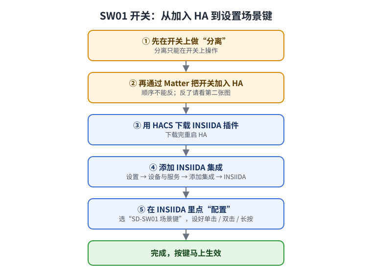
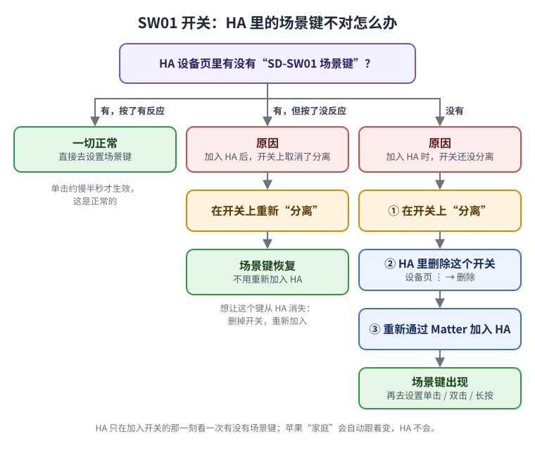

# INSIIDA

**中文** | [English](README.en.md)

[](https://my.home-assistant.io/redirect/hacs_repository/?owner=insiida&repository=insiida-home-assistant&category=integration)
[](https://my.home-assistant.io/redirect/config_flow_start/?domain=insiida)

[](https://hacs.xyz/)
[](https://github.com/insiida/insiida-home-assistant/releases)
[](https://github.com/insiida/insiida-home-assistant/actions/workflows/validate.yaml)

<!-- 截图待补：docs/images/ -->

## 简介

**INSIIDA** 是英诺诗达智能开关、传感器在 [Home Assistant](https://www.home-assistant.io/)（简称 HA）上的配套插件。

- 开关通过 Matter 接入 HA 后，就能直接控制，不装插件也可以用；
- 装上插件，可以**点选设置场景键**（单击、双击、长按各做什么），并在设备页面看到**信号强度、重启次数**等诊断信息，方便排查问题。

<!-- 截图：docs/images/overview.png（集成页面 + 设备诊断页） -->

## 插件优势

- **点选就能用**：在插件的“配置”里选好灯、场景或脚本即可，不用写自动化。
- **本地运行**：全部在家里的 HA 里完成，不经过云端，断网也能用。
- **只读不写**：插件只读取设备信息，不会改动开关的设置。
- **好排查**：信号质量（很好 / 良好 / 一般 / 差）、网络角色、重启次数、上次启动时间一目了然。开关偶尔失灵时，能看出是信号问题还是供电问题；还能一键下载诊断文件发给我们。
- **新设备自动接入**：以后再加 INSIIDA 设备，插件会自动发现，不用重新添加。
- **随时可卸**：删掉插件，开关本身照常工作。

## 支持的设备

| 设备 | 开关灯 | 场景键设置 | 诊断信息 |
|---|---|---|---|
| SW01 智能开关 | ✅ HA 自带 | ✅ 一个场景键，需先在开关上“分离”再加入 HA，见下文 | ✅ 信号质量、信号强度、网络角色、重启次数、上次启动时间 |
| SS01 传感器 | ✅ HA 自带 | — | ✅ 同上（固件 1.0.1 起有信号三项，之前只有重启次数、上次启动时间） |

## 一图看懂



## 环境要求

- Home Assistant 2025.1 或更新版本（已在 2026.3 上实测）；
- HA 已开 IPv6：“设置 → 系统 → 网络”，主网口 IPv6 设为“自动”；
- 家里有 Thread 边界路由器（例如 HomePod mini、Apple TV 4K，或 HA 的 Thread 网卡）；
- 设备已通过 Matter 加进 HA：“设置 → 设备与服务 → Matter → 添加设备”；
- 已安装 [HACS](https://hacs.xyz/)（用方式一、方式二时需要）。

## 下载安装

### 方式一：一键打开（推荐）

1. 用手机或电脑打开本页，点最上面的 **“打开 HACS 安装”** 按钮；
2. 第一次使用会让你填 HA 的地址，填好后点“打开链接”；
3. HA 里会直接打开 INSIIDA 的页面，点右下角 **“下载”**；
4. 下载完，按提示**重启 HA**。

<!-- 截图：docs/images/install_hacs.png -->

### 方式二：在 HACS 里添加

1. 打开 HACS → 右上角 **⋮** → **“自定义存储库”**；
2. “存储库”填 `https://github.com/insiida/insiida-home-assistant`，“类别”选 **“集成”**，点“添加”；
3. 在 HACS 里搜 **INSIIDA**，点进去 → **“下载”**；
4. 下载完**重启 HA**。

> 等 INSIIDA 被收录进 HACS 默认商店后，可以跳过第 1、2 步，直接在 HACS 里搜 “INSIIDA”。

### 方式三：手动复制

适合不用 HACS 的用户：

1. 下载本仓库最新的 [Release](https://github.com/insiida/insiida-home-assistant/releases) 压缩包；
2. 把里面的 `custom_components/insiida` 文件夹复制到 HA 配置目录下的 `custom_components` 里；
3. 重启 HA。

## 添加集成

1. 点最上面的 **“添加 INSIIDA 集成”** 按钮；
   也可以在 HA 里进“设置 → 设备与服务 → 添加集成”，搜 **INSIIDA**；
2. 页面会列出找到的 INSIIDA 设备，点 **“提交”**。

完成后，每个 INSIIDA 设备的页面里都会多出“诊断”信息：

| 项目 | 怎么看 |
|---|---|
| 信号质量 | **很好**、**良好**：放心用；**一般**：偶尔可能反应慢；**差**：容易掉线，可以在附近加一个通电的 Matter/Thread 设备帮忙转发 |
| 信号强度 | 信号质量对应的具体数值（dBm），越接近 0 越好：-65 及以上为“很好”，-66 ~ -75 为“良好”，-76 ~ -85 为“一般”，低于 -85 为“差” |
| 网络角色 | **路由**：开关通电，会帮别的设备转发信号；**主路由**：负责管理整个网络；**备用路由**：需要时可以升为路由；**终端**、**省电终端**：只连别人，不帮忙转发；**未加入**：还没连上网络 |
| 重启次数 | 正常很少增加。经常变多，说明设备在反复断电或重启，检查供电和接线 |
| 上次启动时间 | 设备最近一次开机的时间 |

诊断数值大约每 10 分钟更新一次。设备离线时，这些诊断项会显示“不可用”。

信号质量、信号强度、网络角色这三项要固件支持才有（SS01 固件 1.0.1 之前没有）。固件没有时这三项不显示；以后升级到支持的固件，插件会自动补上，不用重装。

**遇到问题要联系我们时**：在设备页面右上角 **⋮** → **“下载诊断信息”**，把下载的文件发给我们。文件里只有插件的设置和上面这些诊断数据，不含配对码、密码等隐私信息。

<!-- 截图：docs/images/add_integration.png、docs/images/diagnostics.png -->

## 设置场景键

1. 先在开关上做“分离”，再把开关加入 HA（顺序很重要，见下面“先分离，再加入 HA”）；
2. HA 里进“设置 → 设备与服务 → INSIIDA”，点 **“配置”**；
3. 选场景键（显示为“SD-SW01 场景键”），点“提交”；
4. 按需要选好：
   - **单击**：开关哪些灯（选多盏时，有一盏开着就全关，全关着就全开）；
   - **双击**：启动哪些场景或脚本；
   - **长按**：启动哪些场景或脚本；
5. 点“提交”，马上生效。不需要的按法留空即可。

<!-- 截图：docs/images/options_key.png -->

**先“分离”，再加入 HA**

SW01 的场景键要在开关上做了“分离”才会出现（分离只能在开关上操作），而且 HA 只在加入开关的那一刻看一次：

| 情况 | HA 里的场景键 | 怎么做 |
|---|---|---|
| 先在开关上分离，再加入 HA | 有，能用 | 不用做什么（推荐这样） |
| 先加入了 HA，后来才分离 | 没有 | 在 HA 里删掉这个开关，重新加入 |
| 加入后取消了分离 | 还显示着，但按了没反应 | 再分离就恢复；想让它消失就删掉重加 |



苹果“家庭”会自动跟着分离变化，HA 不会，所以两边看到的可能不一样，这是正常的。

**按键小知识**

- **单击会慢半拍（约半秒）**：开关要先确认你不是在双击，再发出“单击”，这是正常的。
- **双击要按得快**：两下要像双击鼠标那样连着按，中间停顿稍长，会被当成两次单击。

## 不想装插件：用场景键蓝图

蓝图是 HA 自带的功能，不用装 HACS，也不用重启。

[](https://my.home-assistant.io/redirect/blueprint_import/?blueprint_url=https%3A%2F%2Fgithub.com%2Finsiida%2Finsiida-home-assistant%2Fblob%2Fmain%2Fblueprints%2Fautomation%2Finsiida%2Finsiida_sw01_scene_key.yaml)

点“导入蓝图”，导入后点“创建自动化”，选好场景键，再给单击、双击、长按各选要做的事，保存即可。

如果按钮用不了：“设置 → 自动化与场景 → 蓝图 → 导入蓝图”，粘贴下面的地址：

```
https://github.com/insiida/insiida-home-assistant/blob/main/blueprints/automation/insiida/insiida_sw01_scene_key.yaml
```

**同一个按键只选一种方式**：插件和蓝图不要给同一个键的同一种按法都设动作，否则会执行两遍。

## 卸载

1. “设置 → 设备与服务 → INSIIDA” → **⋮** → **“删除”**；
2. HACS 里找到 INSIIDA → **⋮** → **“删除”**；
3. 重启 HA。

开关和传感器本身不受任何影响。

## HA 升级会不会影响插件？

- **开关本身完全不受影响**：开关灯、墙上按键、语音控制都走 HA 自带的 Matter。
- **场景键设置**：只用到 HA 公开的功能，升级后一般照常工作。
- **诊断信息**：如果某次 HA 大版本升级改了 Matter 内部，诊断信息可能暂时显示“不可用”，但场景键照常工作，也不会让 HA 出错。我们会跟着 HA 的新版本测试，出问题时在 HACS 里发更新，点“更新”即可。

## 进阶玩法

### 脚本 + 卡片

想让手机上的卡片和墙上的按键做同一件事：

1. 新建一个脚本，写上“单击要做的事”，示例见 [`cards/sw01_script_example.yaml`](cards/sw01_script_example.yaml)；
2. 在插件或蓝图里，让单击运行这个脚本；
3. 仪表盘卡片点击时也运行这个脚本。

以后只改这个脚本，墙上的键和手机卡片会一起变。

### 苹果风格卡片

[`cards/sw01_apple_style.yaml`](cards/sw01_apple_style.yaml) 是苹果“家庭”风格的两张卡片，需要先通过 HACS 安装 **button-card**。
不想装额外卡片，可以用 [`cards/sw01_tile_basic.yaml`](cards/sw01_tile_basic.yaml)，只用 HA 自带卡片。

用法：仪表盘右上角“编辑 → 添加卡片 → 手动”，粘贴后把里面的实体名换成你自己的。

## 常见问题

- **在“添加集成”里搜不到 INSIIDA**：要先通过 HACS 下载插件并重启 HA，才搜得到。
- **在 HACS 里搜不到 INSIIDA**：收录进 HACS 默认商店之前，要先按“方式二”添加自定义存储库，或用“方式一”的按钮。
- **添加开关一直失败**：多半是 HA 没开 IPv6，见“环境要求”。
- **配置里没有场景键**：开关要先在开关上“分离”，再加入 HA；已经加入的，删掉重新加入。见上面的流程图。
- **按场景键没反应**：在 HA 设备页看“按钮”的记录里有没有收到按键；没有收到，检查开关是不是还在“分离”状态。
- **双击总被当成两次单击**：按快一点，见“按键小知识”。
- **按一下做了两遍**：同一个键在插件和蓝图里都设了动作，删掉其中一个。

## 问题反馈

请在 [Issues](https://github.com/insiida/insiida-home-assistant/issues) 里提交，附上 HA 版本、设备型号和问题描述。

## 许可证

本插件以 [Apache License 2.0](LICENSE) 开源。
